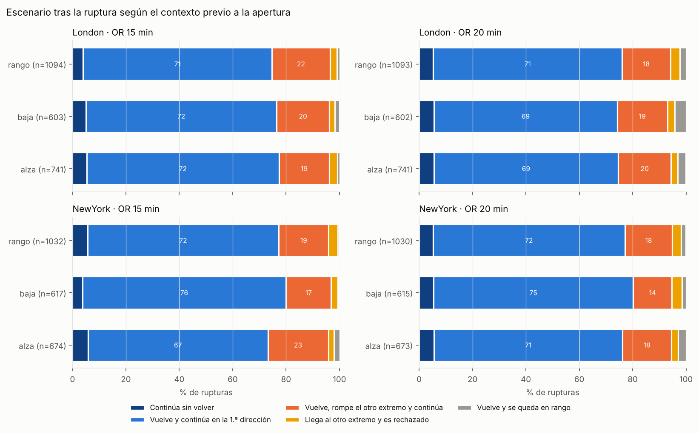
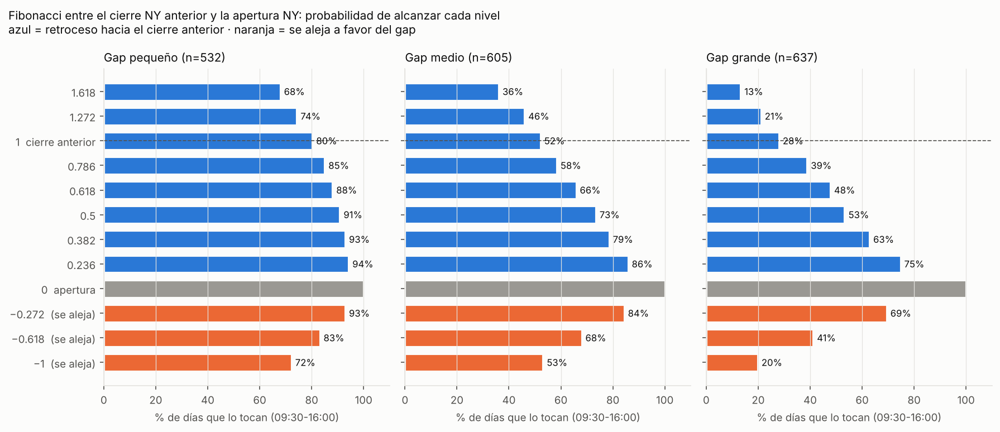
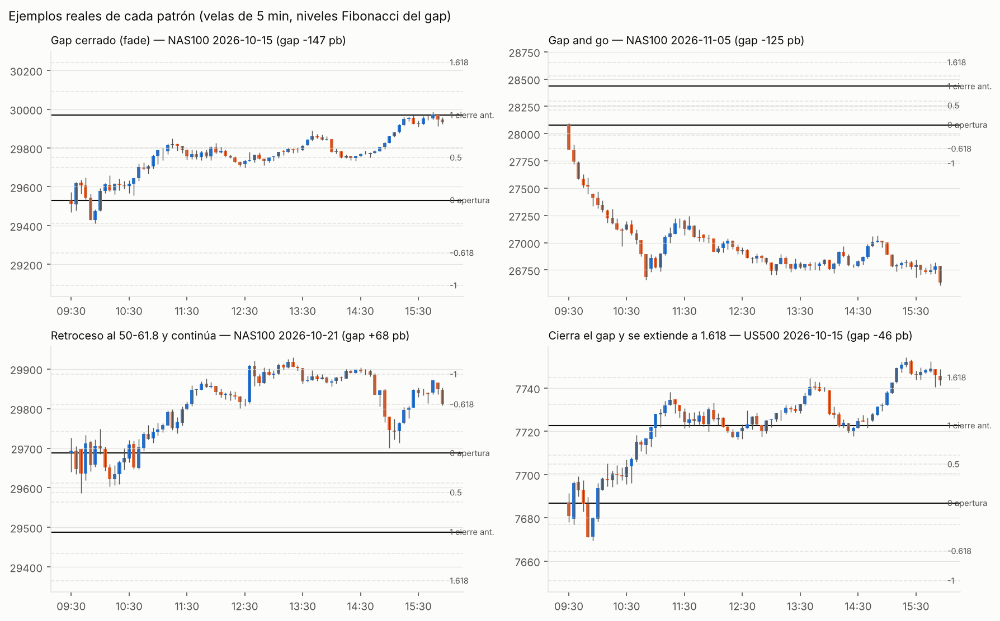

# ORB + Fibonacci: rango de apertura de Londres y Nueva York en Nasdaq 100 y S&P 500

Estudio estadístico de la estrategia *Opening Range Breakout* (ORB) con niveles Fibonacci, con
datos de **1 minuto desde enero de 2022 hasta noviembre de 2026**. Incluye:

- una **base de datos SQLite** de aperturas, rupturas, escenarios y gaps;
- un **agente analista**, que busca en qué condiciones cambian las probabilidades y si los
  eventos se repiten;
- un **agente de estrategia**, que prueba patrones con el Fibonacci entre el cierre de Nueva York
  y la apertura de Nueva York del día siguiente;
- un **dashboard** interactivo y un indicador Pine v6 para TradingView.

> **Aviso:** es un proyecto de investigación, no asesoramiento financiero. Las probabilidades
> pasadas no garantizan resultados futuros.

**Dashboard:** https://claude.ai/artifact/6zyYorAnAspRnYcSZG4XYx

## Datos

| | |
|---|---|
| Instrumentos | **NAS100** (CFD Nasdaq 100, `USATECHIDXUSD`) y **US500** (CFD S&P 500, `USA500IDXUSD`) |
| Período | 2022-01-03 → 2026-11-06, velas de 1 minuto (≈1,6 millones por índice) |
| Fuente | Serie de Dukascopy. Años y meses cerrados de [HistData](https://www.histdata.com) (`NSXUSD`, `SPXUSD`), cuyos precios coinciden minuto a minuto con el datafeed de Dukascopy (comprobado en invierno y en verano). Los días sueltos se completan con el datafeed. |
| Validación | *In-sample* 2022-2024 · *out-of-sample* 2025-2026 · estabilidad año a año |

Los CFD cotizan casi 24 horas, así que cubren la apertura de Londres. Se excluyen fines de semana y
festivos de cada bolsa. Total: **9.535 rangos de apertura y 9.515 rupturas**, además de 1.774 días
con gap.

El primer estudio de 6 meses con perpetuos de Binance sigue en `results/binance/`.

## Qué mide

1. **Rango de apertura (OR).** Máximo y mínimo de los primeros **15 o 20 minutos** desde las
   **08:00 de Londres** y las **09:30 de Nueva York**, en hora local de cada ciudad (con los cambios de
   horario de verano de cada una).
2. **Ruptura.** Es la primera vela que **cierra** fuera del rango. El precio se sigue hasta las
   12:00 en Londres y las 16:00 en Nueva York.
3. **Fibonacci del rango.** Se mide en unidades de R = máximo − mínimo, orientado a la ruptura:
   0 = nivel roto, 0,5 = mitad, 1 = extremo opuesto. Las extensiones 1,272 / 1,618 / 2,0 / 2,618 van
   más allá del nivel roto. Se guarda el minuto del primer toque de cada nivel.
4. **Contexto antes de cada apertura.** En Londres se mira de 00:00 a 08:00 (Asia) y en Nueva York
   de 04:00 a 09:30 (Europa y *premarket*). Si el cambio neto es al menos el 40 % del rango de esa
   ventana, el precio venía **al alza** o **a la baja**; si no, en **rango**. También se guarda la
   **tendencia diaria** (cierre frente a la SMA20 y su pendiente) y la dirección del día anterior.
5. **Escenario tras la ruptura** (el árbol del dashboard):

   | Escenario | Qué pasa |
   |---|---|
   | Continúa sin volver | Nunca vuelve a tocar el nivel roto |
   | Vuelve y continúa en la 1.ª dirección | Toca el nivel roto y después llega a 1,272 a favor, antes de tocar el otro extremo |
   | Vuelve, rompe el otro extremo y continúa | Llega al extremo opuesto y se extiende 0,272 R más allá |
   | Llega al otro extremo y es rechazado | Toca el extremo opuesto pero no se extiende |
   | Vuelve y se queda en rango | No llega ni a 1,272 ni al otro extremo |

   En la base de datos también están las versiones con 1,618 y 2,0 como umbral de continuación.
6. **Fibonacci del gap.** Se traza entre el **cierre de Nueva York (16:00) del día anterior** y la
   **apertura de Nueva York (09:30)**: p = 0 es la apertura, p = 1 el cierre anterior (gap cerrado),
   1,272 y 1,618 quedan más allá del cierre y −0,272 / −0,618 / −1 se alejan a favor del gap. Los gaps
   menores del 10 % del rango diario medio cuentan como planos.

## Resultados 2022-2026

### Qué pasa después de la ruptura (NAS100 + US500)

| | Londres 15m | Londres 20m | NY 15m | NY 20m |
|---|---:|---:|---:|---:|
| Rupturas | 2.438 | 2.436 | 2.323 | 2.318 |
| **Vuelve al nivel roto** | **95 %** | **95 %** | **95 %** | **95 %** |
| Retrocede al 50 % | 73 % | 69 % | 72 % | 67 % |
| **Toca el extremo opuesto** | **54 %** | **48 %** | **54 %** | **48 %** |
| Llega a 1,618 | 75 % | 71 % | 77 % | 73 % |
| Escenario: continúa sin volver | 4,6 % | 5,5 % | 5,2 % | 5,4 % |
| Escenario: vuelve y continúa en la 1.ª dirección | **71,3 %** | 69,7 % | **71,7 %** | 72,3 % |
| Escenario: vuelve, rompe el otro extremo y continúa | **20,3 %** | 18,8 % | **19,3 %** | 17,0 % |
| Escenario: llega al otro extremo y es rechazado | 2,5 % | 3,0 % | 2,8 % | 3,2 % |
| Escenario: vuelve y se queda en rango | 1,2 % | 3,0 % | 1,1 % | 2,1 % |

Con 1,618 como umbral, «vuelve y continúa» baja a cerca del 55 % y los giros suben. El dashboard
permite cambiar el umbral.

### Agente analista: qué condiciones cambian las probabilidades

Hizo 1.815 pruebas y encontró **51 efectos estables**: significativos tras corregir por pruebas
múltiples, de al menos 5 puntos y con el mismo signo en 2022-2024, en 2025-2026 y en al menos el 75 %
de los años. Detalle en [`results/dukascopy/analyst/ANALISTA.md`](results/dukascopy/analyst/ANALISTA.md).

- **El tamaño del rango de apertura es lo que más pesa,** medido frente al rango diario medio. Con
  un OR **pequeño** se toca el extremo opuesto un 60-66 % de las veces (base: 48-54 %) y se llega a
  1,618 un 80-84 %. Con un OR **grande** el extremo opuesto baja al 38-45 % y 1,618 al 59-69 %.
  Se cumple los 5 años.
- **El contexto previo influye poco.** En Nueva York, cuando el precio venía **a la baja**, «vuelve y
  continúa» sube al 76 % y el giro baja al 17 %. Cuando venía **al alza**, el giro sube al 23 %. Que la
  ruptura vaya a favor o en contra del movimiento previo cambia unos 4 puntos como mucho.
- **Miércoles en Nueva York:** más retrocesos al 50 % (+7 pp) y más toques del extremo opuesto.
- **Si Nueva York abre por debajo del mínimo del día anterior,** «vuelve y continúa» sube al 79 % con
  OR de 20 minutos.
- **Los escenarios no se repiten de un día a otro.** Que ayer hubiera giro no cambia la probabilidad
  de giro hoy: la diferencia frente a la base está entre −3,5 y +0,2 pp. Tampoco hay relación entre la
  dirección de Londres y la de Nueva York.



### Agente de estrategia: Fibonacci cierre NY → apertura NY



| Gap (en % del rango diario medio) | Días | Retrocede al 50 % | **Cierra el gap (1,0)** | Llega a 1,618 | Se aleja −1 |
|---|---:|---:|---:|---:|---:|
| Pequeño (10-25 %) | 532 | 91 % | **80 %** | 68 % | 72 % |
| Medio (25-50 %) | 605 | 73 % | **52 %** | 36 % | 53 % |
| Grande (> 50 %) | 637 | 53 % | **28 %** | 13 % | 20 % |

- **La primera ruptura del OR15 es la mejor pista.** Si rompe **hacia el cierre anterior**, el gap
  se cierra el **70 %** de los días y el 50 % se toca el 89 %. Si rompe **a favor del gap**, solo se
  cierra el 34 % y el precio se aleja −0,618 el 80 % de los días.
- Si Nueva York abre **dentro del rango del día anterior**, el gap se cierra el 62 %. Si abre fuera,
  entre el 36 % y el 45 %.
- Patrones probados: 5 familias con variantes de stop y objetivo, 232 combinaciones de variante y
  filtro con al menos 40 operaciones IS.

| Patrón | Mejor variante IS | R IS | R OOS | Años + |
|---|---|---:|---:|---:|
| P1 Fade del gap en la apertura | obj 0,618 · stop −0,272 · gap grande | +0,06 | −0,03 | 3/5 |
| P2 Fade tras ruptura del OR hacia el cierre | obj 0,618 · stop extremo OR · gap grande | +0,12 | −0,05 | 3/5 |
| P3 Gap and go (ruptura del OR a favor del gap) | obj 2R · stop extremo OR · gap grande | +0,13 | −0,12 | 2/5 |
| P4 Retroceso Fibonacci y continuación | entrada 0,618 · stop 1,272 · obj 0 | +0,07 | −0,26 | 2/5 |
| **P5 Gap cerrado y extensión** | **stop 0,618 · obj 1,618 · gap grande** | **+0,14** | **+0,27** | **4/5** |

  **P5** consiste en que, con un gap grande, cuando el precio llega al cierre del día anterior se
  entra a favor de ese movimiento, con stop en 0,618 y objetivo en 1,618. Es el único patrón cuya
  mejor variante IS sigue ganando en OOS, en los dos índices (NAS100 +0,20 R, US500 +0,35 R) y en
  2023, 2024, 2025 y 2026 (2022 −0,03 R). Son unas 40 operaciones al año. Es un **candidato** y no
  una ventaja demostrada: salió de entre 240 combinaciones probadas y la muestra OOS es de 83
  operaciones.
  Detalle en [`results/dukascopy/strategy/ESTRATEGIA.md`](results/dukascopy/strategy/ESTRATEGIA.md).



### Reglas ORB puras (continuación / reversión)

Ninguna de las 448 reglas de entrada, stop y objetivo sobre el rango de apertura es positiva a la
vez en IS y OOS. La expectativa media bruta es −0,02 a −0,05 R y la neta de −0,2 a −0,4 R. Con 5
años de datos se confirma lo que se vio en 6 meses: **las probabilidades del rango sirven para
gestionar la operación, pero por sí solas no dan una ventaja mecánica.**

## Estructura

```
orb/config.py               Sesiones, festivos 2022-2026, niveles, contexto, gap, fuentes de datos
orb/engine.py               Eventos ORB, contexto previo, escenarios, gap Fibonacci, simulador
orb/histdata.py             Descarga HistData (1 min, ZIP anual/mensual) + relleno con Dukascopy
orb/dukascopy.py            Descarga del datafeed de Dukascopy (1 archivo por día, con límite de velocidad)
orb/database.py             SQLite: velas, eventos, gaps, reglas; importación de CSV propios
orb/run_study.py            Estudio ORB: probabilidades, rejilla de reglas IS/OOS, gráficos
orb/agents/analyst.py       Agente analista
orb/agents/strategy.py      Agente de estrategia (gap Fibonacci)
orb/dashboard/build_data.py Tablas de probabilidad precalculadas para el dashboard
orb/dashboard/index.html    Página del dashboard
orb/run_all.py              Ejecuta todo
orb/pine/orb_fib_indicator.pine   Indicador TradingView
orb/results/dukascopy/      Resultados 2022-2026 (base de datos, CSV, gráficos, informes)
orb/results/binance/        Primer estudio de 6 meses
```

## Uso

```bash
pip install -r requirements.txt
python3 orb/run_all.py                    # descarga (1.ª vez), base de datos, agentes y dashboard
python3 orb/run_all.py --source binance   # estudio de 6 meses con Binance
```

La primera descarga baja unos 30 ZIP de HistData. Después, todo el flujo tarda unos 2 minutos.

### Consultar la base de datos

```sql
-- sqlite3 orb/results/dukascopy/orb_study.sqlite
SELECT * FROM v_breakout_summary;

-- Escenario según el contexto previo en Nueva York (OR 15)
SELECT pre_trend, scenario, COUNT(*) FROM events
WHERE session='NewYork' AND or_min=15 AND break_dir!='none' GROUP BY 1, 2;

-- Cierre del gap según la tendencia diaria
SELECT daily_trend, gap_size, ROUND(100.0*AVG(t_fill_1000 IS NOT NULL),1) AS pct_cierra
FROM gaps WHERE gap_dir!='plano' GROUP BY 1, 2;
```

Tablas: `events` (aperturas y rupturas, con `pre_trend`, `daily_trend`, `scenario`,
`scenario_1618`, `scenario_20` y los minutos hasta cada nivel), `gaps` (con `t_fill_*` y `t_away_*`),
`strategy_grid` y `trades`. La base de datos completa con velas de 1 minuto se genera en
`orb/data/` y no se versiona.

### Usar tus propios datos

```bash
python3 orb/run_study.py --source csv --csv NAS100=nas100_m1.csv --tz Europe/Athens
```

Acepta exportaciones de 1 minuto de MT5 o de TradingView (ver `database.import_csv`).

### Indicador de TradingView

Pega `orb/pine/orb_fib_indicator.pine` en el Pine Editor y úsalo en un gráfico de 1 a 5 minutos.
Dibuja el OR de Londres y de Nueva York con sus retrocesos y extensiones y marca la ruptura y el
retest. Tras la ruptura proyecta la **extensión 1,618** con la probabilidad de alcanzarla, que se
actualiza en vivo según el tamaño del rango (frente al rango medio diario de NY de 20 días) y según
si el precio ya retrocedió al 50 % o tocó el extremo opuesto. No se ha podido compilar desde este
entorno.

## Limitaciones

- **CFD, no futuros.** La serie de Dukascopy sigue al índice de contado. NQ/ES pueden diferir un poco
  en la apertura de Londres.
- **Velas de 1 minuto.** El orden de los precios dentro de un minuto es desconocido. Cuando el stop y
  el objetivo caen en la misma vela, se resuelve de forma conservadora (stop primero).
- **Pruebas múltiples.** El analista corrige por ellas. En los patrones, cualquier variante positiva
  debe confirmarse con datos nuevos antes de operarla.
- **Costes.** Se usa 1 pb por lado. En Londres el OR mediano es de unos 13 pb, así que los costes
  pesan mucho.
