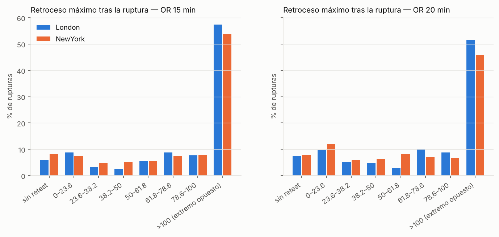
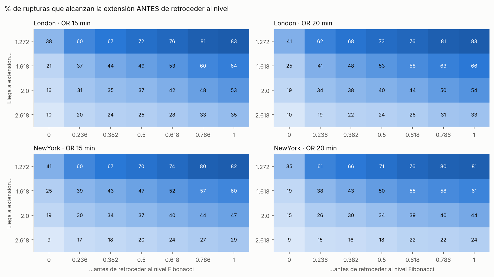
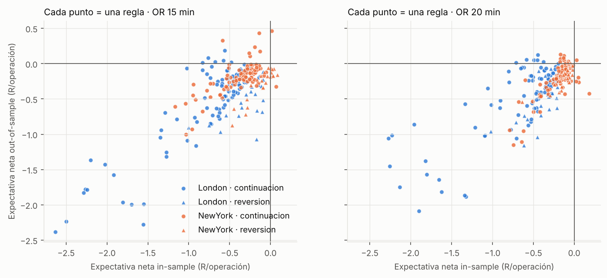

# ORB + Fibonacci: rango de apertura de Londres y Nueva York en Nasdaq 100 y S&P 500

Estudio estadístico de la estrategia *Opening Range Breakout* (ORB) con niveles Fibonacci. Incluye
una base de datos SQLite de eventos, tablas de probabilidad y una rejilla de reglas validada
*in-sample* / *out-of-sample*. También hay un indicador Pine v6 para ver los niveles en TradingView.

> **Aviso:** es un proyecto de investigación, no asesoramiento financiero. Los resultados se han
> obtenido con *proxies* de datos y no garantizan resultados futuros.

## Qué mide

1. **Rango de apertura (OR).** Máximo y mínimo de los primeros **15 o 20 minutos** desde la apertura
   de **Londres (08:00, hora de Londres)** y de **Nueva York (09:30, hora de Nueva York)**. Las horas
   se convierten a UTC día a día, así que se respetan los cambios de horario de verano de cada ciudad.
2. **Ruptura.** Es la primera vela de 1 minuto que **cierra** fuera del rango. Se registra la
   dirección (alcista o bajista) y los minutos que tarda en producirse. El precio se sigue hasta las
   12:00 en Londres y hasta las 16:00 en Nueva York.
3. **Retroceso o no.** Tras la ruptura se mide si el precio vuelve al nivel roto (*retest*), hasta qué
   nivel Fibonacci del rango retrocede y si llega a romper el extremo opuesto (ruptura fallida).
4. **Fibonacci entre el máximo y el mínimo del OR.** Los niveles se miden en unidades del rango
   R = máximo − mínimo y se orientan en la dirección de la ruptura:

   | Nivel | Significado (ruptura alcista; la bajista es simétrica) |
   |---|---|
   | Retroceso 0 | El máximo del OR, es decir, el nivel roto |
   | Retroceso 0,236 / 0,382 / 0,5 / 0,618 / 0,786 | Dentro del rango, medidos desde el máximo hacia el mínimo |
   | Retroceso 1 | El mínimo del OR, el extremo opuesto |
   | Extensión 1,272 / 1,618 / 2,0 / 2,618 | Máximo + 0,272 / 0,618 / 1 / 1,618 × R |

   Para cada ruptura se guarda **cuántos minutos tarda en tocar cada nivel** por primera vez. Con eso,
   cualquier pregunta del tipo *"¿llega a 1,618 antes de retroceder al 50 %?"* es una consulta SQL.
5. **Reglas.** Se prueban dos modelos:
   - **Continuación** (a favor de la ruptura). Entrada al cierre de la ruptura o con orden límite en un
     retroceso (0 / 0,236 / 0,382 / 0,5). Stop en un retroceso más profundo. Objetivo en una extensión.
   - **Reversión** (en contra de la ruptura). Entrada al cierre de la ruptura o con orden límite en una
     extensión (1,272 / 1,618). Stop en una extensión mayor. Objetivo de vuelta al rango (0 / 0,5 / 1).

   Las reglas se eligen solo con **mayo-agosto** (*in-sample*) y se comprueban en
   **septiembre-noviembre** (*out-of-sample*). El coste es de 1 punto básico por lado. Cuando el stop
   y el objetivo caen en la misma vela, se cuenta el stop.

## Datos

Son **6,4 meses** (2026-05-01 → 2026-11-11) de velas de **1 minuto** de los perpetuos de Binance
**QQQUSDT** (proxy del Nasdaq 100) y **SPYUSDT** (proxy del S&P 500). Son gratuitos y cotizan
24 horas, así que también cubren la apertura de Londres. Se excluyen los fines de semana y los
festivos de cada bolsa. En total hay 1.084 rangos de apertura y 1.081 rupturas.

Si tienes datos de tu bróker (NAS100, US500, NQ, ES), puedes usarlos en su lugar. Consulta
[Usar tus propios datos](#usar-tus-propios-datos).

## Resultados principales

### Lo que pasa después de la ruptura (QQQ y SPY juntos)

| | Londres 15m | Londres 20m | NY 15m | NY 20m |
|---|---:|---:|---:|---:|
| Días con ruptura | 100 % | 100 % | 100 % | 99 % |
| Rupturas alcistas | 55 % | 56 % | 56 % | 56 % |
| **Vuelve al nivel roto (retest)** | **94 %** | **93 %** | **92 %** | **92 %** |
| No vuelve | 6 % | 7 % | 8 % | 8 % |
| Retrocede al 38,2 % | 82 % | 78 % | 80 % | 74 % |
| Retrocede al 50 % | 79 % | 73 % | 74 % | 68 % |
| Retrocede al 61,8 % | 74 % | 70 % | 69 % | 60 % |
| **Toca el extremo opuesto (100 %)** | **57 %** | **52 %** | **54 %** | **46 %** |
| Llega a la extensión 1,272 | 92 % | 91 % | 90 % | 87 % |
| Llega a la extensión 1,618 | 79 % | 77 % | 73 % | 69 % |
| Llega a la extensión 2,0 | 64 % | 63 % | 57 % | 52 % |
| **1,618 antes de retroceder al 50 %** | **49 %** | **53 %** | **47 %** | **50 %** |




### Lectura

- **Casi siempre hay retroceso.** En más del 90 % de las rupturas el precio vuelve al nivel roto, y
  en unas 3 de cada 4 llega al 50 % del rango. Perseguir la ruptura sin esperar al retroceso
  significa casi siempre aguantar un drawdown.
- **La mitad de las rupturas acaban tocando el extremo opuesto.** Es el resultado más llamativo.
  En este período el rango de apertura funcionó más como zona de rango que como punto de partida
  de una tendencia.
- **Que la extensión llegue antes que el retroceso es una moneda al aire.** Llegar a 1,618 antes de
  volver al 50 % ocurre entre el 47 % y el 53 % de las veces. Ningún nivel Fibonacci separa con
  claridad las rupturas buenas de las malas.
- **El OR de 20 minutos y los rangos grandes fallan menos.** En Nueva York, con OR de 20 minutos, el
  extremo opuesto se toca un 46 % de las veces, frente al 54 % con 15 minutos. Por tamaño de rango,
  el tercio grande toca el extremo opuesto entre un 30 % y un 44 % de las veces y el tercio pequeño
  entre un 52 % y un 64 % (`results/binance/conditional_probabilities.csv`).
- **Londres no predice Nueva York.** Nueva York rompe en la misma dirección que Londres el 51 % de
  los días. Hay un subgrupo aparente: cuando Nueva York abre en el tramo 61,8-100 % del rango de
  Londres, coincide en el 83 % de los casos, pero son solo 12 días.

### Reglas (448 combinaciones con al menos 25 operaciones *in-sample*)

| | Expectativa media bruta IS | Bruta OOS | Neta IS | Neta OOS |
|---|---:|---:|---:|---:|
| Continuación | −0,14 R | +0,02 R | −0,52 R | −0,38 R |
| Reversión | −0,02 R | −0,14 R | −0,23 R | −0,37 R |

- **Ninguna regla es robusta.** Solo 2 de 448 son positivas a la vez en IS y en OOS, y ninguna lo es
  en los dos índices por separado. Con tantas combinaciones probadas, es lo que cabe esperar por puro
  azar.
- La mejor regla de cada sesión elegida en IS **pierde en OOS** (`results/binance/equity_selected.png`).
- **Hubo un cambio de régimen.** En IS funcionaba algo mejor la reversión y en OOS la continuación.
  Una regla fija de ORB y Fibonacci no se sostuvo en este período.
- **Los costes pesan mucho en Londres.** La mediana del rango es de solo 8 pb en SPY y 16 pb en QQQ,
  así que 2 pb de ida y vuelta se comen buena parte de cada operación. En Nueva York el rango es de
  23 a 54 pb.



**Conclusión.** La base de datos sirve para conocer las probabilidades, por ejemplo que casi siempre
habrá retest, que hay un 75 % de probabilidad de tocar el 50 % y un 50 % de tocar el extremo
opuesto. Úsalas para gestionar la operación: dónde poner el stop, dónde no perseguir el precio y
dónde recoger beneficios. Por sí solas no dan una ventaja mecánica en estos 6 meses de datos proxy.
Antes de operar con dinero real, valida con datos reales del subyacente y más historia. Consulta
[Siguientes pasos](#siguientes-pasos).

## Estructura

```
orb/config.py              Sesiones, horarios, festivos, niveles Fibonacci, rejilla de reglas, costes
orb/engine.py              Extracción de eventos (OR, ruptura, retrocesos, extensiones) y simulador
orb/database.py            Carga Binance / CSV propio, SQLite (tablas y vistas)
orb/run_study.py           Ejecuta todo: base de datos → probabilidades → reglas → gráficos → informe
orb/pine/orb_fib_indicator.pine   Indicador TradingView: OR Londres/NY + niveles Fibonacci + rupturas
orb/results/binance/REPORT.md      Todas las tablas (generado)
orb/results/binance/orb_study.sqlite      Base de datos de eventos y reglas (sin velas, ~0,5 MB)
orb/results/binance/*.csv, *.png   Eventos, resúmenes, rejilla de reglas, operaciones y gráficos
orb/data/orb.sqlite        Base de datos completa con velas de 1 minuto (se genera, no se versiona)
```

## Uso

```bash
pip install -r requirements.txt
python3 orb/run_study.py          # descarga datos (1.ª vez), crea la BD y regenera orb/results/
```

Para cambiar el período, las sesiones, los minutos del OR, los niveles o los costes, edita
`orb/config.py`. Una ejecución completa tarda unos 15 segundos, sin contar la descarga.

### Consultar la base de datos

```sql
-- sqlite3 orb/results/binance/orb_study.sqlite
SELECT * FROM v_breakout_summary;            -- dirección, retest y % de rupturas fallidas
SELECT * FROM v_ext1618_before_ret50;        -- % que llega a 1.618 antes de retroceder al 50 %

-- ¿En NY (OR 15), si la ruptura llega a 1.272, cuántas veces vuelve después al 50 %?
SELECT ROUND(100.0*AVG(COALESCE(t_ret_0500 > t_ext_0272, 0)), 1)
FROM events WHERE session='NewYork' AND or_min=15 AND t_ext_0272 IS NOT NULL;
```

Columnas de `events`: `or_high`, `or_low`, `or_range_bp`, `break_dir`, `min_to_break`, `retest`,
`max_retrace`, `max_ext`, `opposite_break`, `close_x` (cierre del horizonte en unidades de R) y los
minutos hasta cada nivel: `t_ret_0000` … `t_ret_1000` y `t_ext_0272` … `t_ext_1618` (NULL si no se toca).

### Usar tus propios datos

Exporta velas de **1 minuto** desde MT5 (*Símbolos → Barras → Exportar*) o desde TradingView
(*Exportar datos del gráfico*) e indica la zona horaria del archivo:

```bash
python3 orb/run_study.py --csv NAS100=nas100_m1.csv --csv US500=us500_m1.csv --tz Europe/Athens
```

Muchos brókeres de MT5 usan la hora del servidor UTC+2/+3, que equivale a `Europe/Athens`. Las
exportaciones de TradingView vienen en tiempo Unix, así que la zona no importa. Ajusta `START` y
`END` en `config.py` al período de tu archivo. Si tienes más historia, cuanta más, mejor.

### Indicador de TradingView

Pega `orb/pine/orb_fib_indicator.pine` en el Pine Editor y úsalo en un gráfico de 1 a 5 minutos.
Dibuja el OR de Londres y de Nueva York con los retrocesos 23,6 / 38,2 / 50 / 61,8 / 78,6 y las
extensiones 1,272 / 1,618 / 2,0 / 2,618. Marca la primera ruptura por cierre y el primer retest, y
muestra una tabla con las probabilidades del estudio. Para el rango de 20 minutos, cambia la sesión a
`0800-0820` o `0930-0950`.

> No se ha podido compilar en TradingView desde este entorno. Si el editor marca algún error,
> indica la línea.

## Limitaciones

- **Proxies.** QQQUSDT y SPYUSDT siguen a QQQ y SPY, pero no son los futuros NQ/ES ni los CFD
  NAS100/US500. La apertura de Londres ocurre de madrugada en EE. UU., cuando la liquidez de estos
  perpetuos es baja.
- **Muestra corta.** Son unos 135 días por sesión y unas 30-60 operaciones OOS por regla. Una
  diferencia de ±5 puntos porcentuales en las probabilidades está dentro del ruido.
- **Velas de 1 minuto.** No se sabe el orden de los precios dentro de cada minuto. Cuando el stop y
  el objetivo caen en la misma vela, se resuelve de forma conservadora.

## Siguientes pasos

1. Repetir el estudio con datos reales de NQ/ES o NAS100/US500 y **2-3 años** de historia, usando
   `--csv`.
2. Probar filtros con lógica previa, no buscados en los resultados: tamaño del OR frente al ATR
   diario, *gap* de apertura, días con noticias (CPI, FOMC, NFP), posición respecto al máximo y el
   mínimo del día anterior.
3. Estudiar la **ruptura fallida** como señal: entrar cuando el precio cierra dentro del rango tras
   romper, con objetivo en el extremo opuesto, que se toca en la mitad de los casos.
4. Validar con *walk-forward* (reoptimizar cada mes) antes de operar en real.
